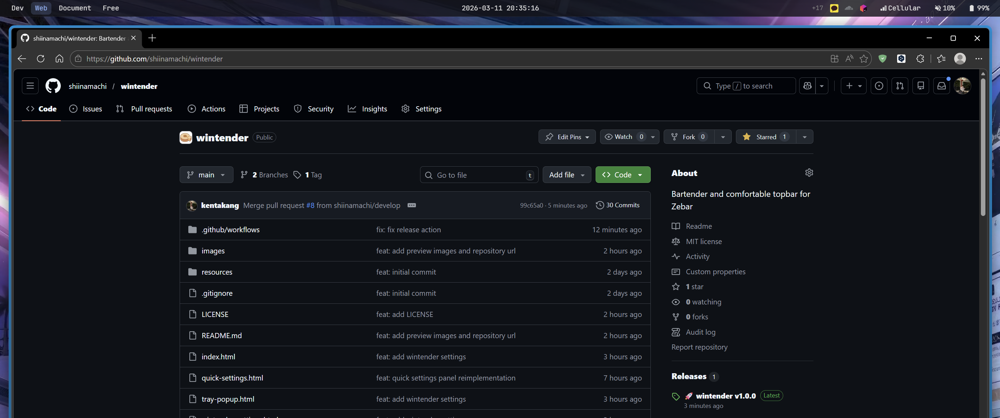
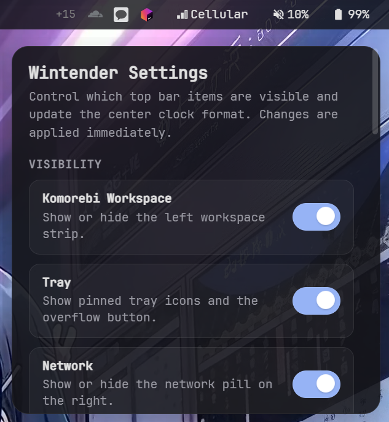
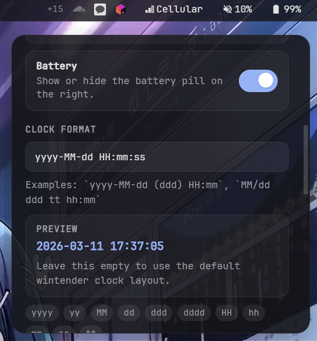
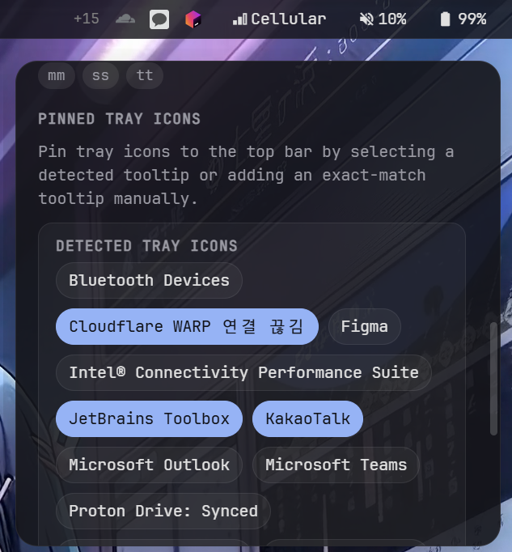

# wintender

Zebar Widgets Pack for Windows 11

The goal is to provide tray icon display and interaction, battery status, network status, and time display through the top bar, similar to macOS's top bar.

Since this is a project primarily for personal use, issues that are reported may not be resolved promptly.

## Features
- Show workspaces on komorebi
- Current time
- Tray icon display and pinned-tray icons (like Bartender on macOS)
- Network, audio, and battery status
- Right click context menu
  - Show task manager
  - Show zebar settings
  - Show wintender settings
- Customizable
- Themes
  - Sakura Night (default): floating acrylic islands in night-sakura pink and nebula cyan
  - Legacy: the original flat bar (choose it in wintender settings)

## Themes
Pick a theme in the Theme section of wintender settings. The change applies to the top bar and every popup immediately.

The Sakura Night bar is 38px tall and the Legacy bar is 32px tall. Zebar reserves the bar's space from the preset it starts with, so when you use the Legacy theme, start the `top-bar` widget with the `legacy` preset in Zebar settings to get the original height. With the `default` preset, the Legacy bar fills the 38px space.

## Screenshots

## License

This project is licensed under the MIT License - see the [LICENSE](LICENSE) file for details.
